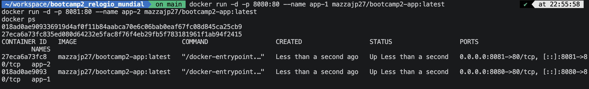

# Relógio Mundial

## Autor
João Pedro Venturoso Mazza — Matrícula 22302176

## Descrição
Aplicação web que exibe a hora atual, a data, o dia da semana e o status de horário de verão de cidades ao redor do mundo. O usuário também pode salvar cidades favoritas, que ficam guardadas em um banco de dados e sobrevivem ao fechamento do navegador.

## Links
- **Aplicação no ar (GitHub Pages):** https://mazzajp27.github.io/bootcamp2_relogio_mundial/
- **Repositório no GitHub:** https://github.com/mazzajp27/bootcamp2_relogio_mundial
- **Imagem no Docker Hub:** https://hub.docker.com/r/mazzajp27/bootcamp2-app

## Como executar

### Com Docker (recomendado)
```bash
docker run -d -p 8080:80 mazzajp27/bootcamp2-app:1.1
```
Depois abra http://localhost:8080. A imagem é multi-plataforma (`linux/amd64` e `linux/arm64`).

### Localmente, sem Docker
1. Clone: `git clone https://github.com/mazzajp27/bootcamp2_relogio_mundial.git`
2. Sirva a pasta com um servidor local (a aplicação usa módulos JavaScript, que não funcionam abrindo o `index.html` direto do disco), por exemplo `python3 -m http.server 8000`, e abra http://localhost:8000

## API utilizada
- [TimeAPI.io](https://timeapi.io), pública e sem chave
- Endpoint: `GET https://timeapi.io/api/time/current/zone?timeZone={fuso_horario}`

## Funcionalidades
- Escolher uma cidade no menu ou digitar qualquer fuso horário IANA (ex.: `Asia/Kolkata`), inclusive buscando com Enter
- Ver hora, data, dia da semana (em português) e status de horário de verão
- Mensagem de erro amigável quando o fuso não existe ou a API está indisponível
- Favoritar uma cidade, listar os favoritos ao abrir a página, reabrir o horário de um favorito e excluí-lo

## Persistência de dados
- **Banco escolhido:** Supabase (PostgreSQL), acessado direto do frontend pela biblioteca `supabase-js`.
- **Tabela favoritos:**

| Coluna | Tipo | Descrição |
|---|---|---|
| `id` | bigint (identity, PK) | identificador do registro |
| `criado_em` | timestamptz | data de criação (padrão `now()`) |
| `nome_item` | text | nome exibido da cidade (ex.: "Tóquio, Japão") |
| `fuso_horario` | text, `unique` | fuso IANA (ex.: `Asia/Tokyo`); impede favoritar a mesma cidade duas vezes |

- **O que é salvo:** as cidades favoritas do usuário. A aplicação cria (Favoritar), lista (seção "Meus favoritos") e exclui (botão 🗑️) registros.
- **Limitação conhecida:** as políticas de acesso (RLS) da tabela estão abertas para o papel `anon` (leitura, inserção e exclusão), como permitido nesta etapa. Não há login, então os favoritos são compartilhados entre todos os visitantes e qualquer pessoa com a chave pública pode alterar os dados. Em produção, as políticas seriam restritas por usuário autenticado.

## Docker

O `Dockerfile` usa `nginx:alpine` e copia apenas `index.html`, `style.css` e `script.js` para a pasta servida pelo Nginx.

## Sidequests

### SQ1 · .dockerignore
O arquivo `.dockerignore` exclui do contexto de build o que não deve ir para a imagem: `.git`, `.gitignore`, `README.md`, `*.md`, `*.png`, `node_modules`, `.DS_Store` e `.vscode`. Antes de cada build, o Docker envia a pasta do projeto inteira (o "contexto de build") para o motor. Ignorar itens como a pasta `.git`, que cresce a cada commit, e as imagens de evidência torna esse envio menor e o build mais rápido. Também protege a imagem contra um futuro `COPY . .` levar arquivos desnecessários para dentro dela, deixando-a menor. No estado atual o `Dockerfile` copia só três arquivos pelo nome, então o ganho no tamanho final é pequeno; o ganho principal é a velocidade do build e a segurança contra esse tipo de deslize.

### SQ2 · Versionamento de imagem
O repositório no Docker Hub tem três tags:
- `1.0`: primeira versão funcional
- `1.1`: após a melhoria de buscar apertando Enter no campo de fuso horário
- `latest`: aponta para a `1.1` (mesmo digest)

### SQ3 · Descrição no Docker Hub
O overview do repositório explica o que é a aplicação, traz o comando `docker run` pronto e o link do repositório no GitHub: https://hub.docker.com/r/mazzajp27/bootcamp2-app

### SQ4 · Explorando a orquestração
Dois containers da mesma imagem rodando ao mesmo tempo, nas portas 8080 e 8081:

```bash
docker run -d -p 8080:80 --name app-1 mazzajp27/bootcamp2-app:latest
docker run -d -p 8081:80 --name app-2 mazzajp27/bootcamp2-app:latest
docker ps
```



**Se eu tivesse 100 containers, como gerenciaria?**

Com 100 containers, gerenciar um a um com `docker run` seria inviável: eu teria que escolher portas, vigiar quais caíram e atualizar cada um manualmente. Para isso existe o Kubernetes, um orquestrador que gerencia os containers de forma declarativa. Ele funciona sobre um **cluster**, um conjunto de máquinas (os nós) em que um plano de controle decide onde cada carga vai rodar. Os containers rodam dentro de **pods**, a menor unidade do Kubernetes. Em vez de subir 100 containers à mão, eu declaro em um **Deployment** que quero, por exemplo, 100 **réplicas** do pod da aplicação, e o Kubernetes distribui essas réplicas pelos nós e mantém sempre esse número no ar: se um container ou um nó falha, ele recria o pod em outro lugar (autocura). Um **Service** oferece um endereço único e faz o balanceamento de carga entre as réplicas, então quem acessa não precisa saber em qual máquina ou porta cada cópia está. O Kubernetes também faz atualizações graduais (rolling update), trocando a versão aos poucos sem derrubar a aplicação, e permite aumentar ou diminuir o número de réplicas, inclusive automaticamente conforme a carga. É a evolução natural do que fiz com os dois containers nas portas 8080 e 8081, só que automatizada e em escala.